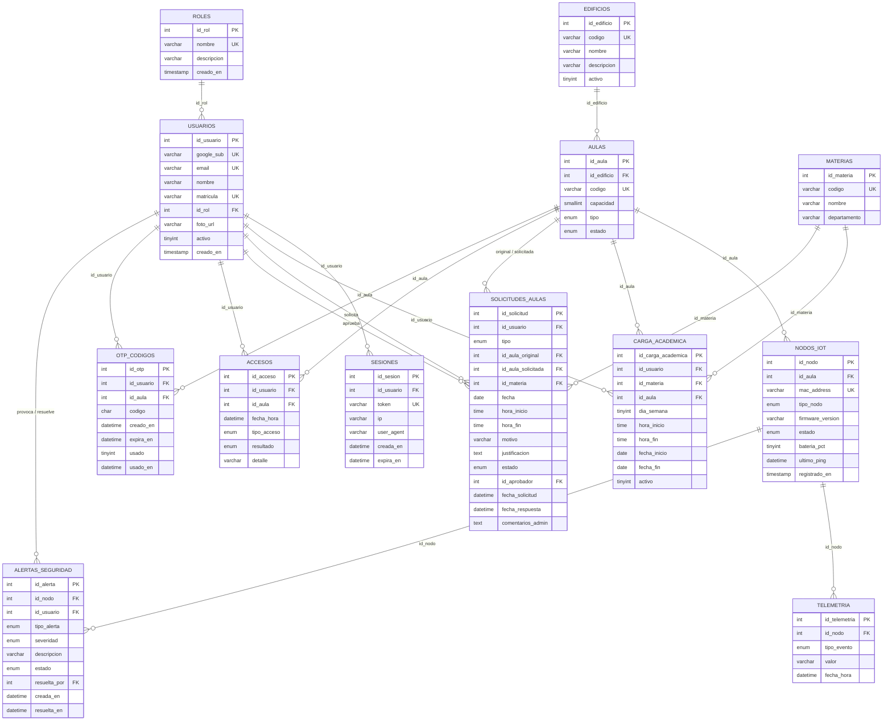

# FASE 1 — Diseño e Implementación de Base de Datos

**Proyecto:** AulaSync — Sistema de Aulas Inteligentes Biométricas (UTM)
**Equipo:** Edgar, Kevin, Valeria y Juan
**Documento de evaluación:** F-SGC-033 · Programación de Redes
**Motor:** MariaDB 10.11 (compatible con MySQL 8)
**Valor de la fase:** 10 %

---

## 1. Entregables de la fase

| Actividad | Entregable | Archivo |
|---|---|---|
| 1.1 Diseño ER y tablas | Diagrama Entidad-Relación editable | `sql/diagrama_er_aulasync.drawio` |
| 1.1 Diseño ER y tablas | Diagrama ER en formato Mermaid (visible en GitHub/VSCode) | Este documento, sección 3 |
| 1.2 Script SQL y usuarios | Script ejecutable con creación de BD, tablas, PK/FK, CHECK, roles y datos de prueba | `sql/schema.sql` |
| 1.2 Script SQL y usuarios | Script de verificación con evidencia (tablas, PK, FK, roles, usuarios) | `sql/verificacion_fase1.sql` |
| Presentación | Reporte visual listo para imprimir / mostrar al docente | `reporte/FASE1_Reporte.pdf` |

---

## 2. Resumen del diseño

- **13 tablas** relacionadas (la rúbrica exige mínimo 5).
- **13 claves primarias** descriptivas (`id_rol`, `id_usuario`, `id_aula`, …).
- **20 claves foráneas** con reglas `ON DELETE` / `ON UPDATE` explícitas.
- **16 restricciones `CHECK`** para validar tipos, rangos, correos, MAC y horas.
- **Motor InnoDB**, `utf8mb4_unicode_ci`, tipos estrictos (`INT UNSIGNED`, `ENUM`, `TINYINT(1)`).
- **Roles de la rúbrica:** `admin` (Admin) y `usuario` (Usuario), más `mantenimiento` como rol técnico opcional.

### 2.1 Tablas y propósito

| # | Tabla | Propósito | PK |
|---|---|---|---|
| 1 | `roles` | Catálogo de roles del sistema (admin, usuario, mantenimiento) | `id_rol` |
| 2 | `usuarios` | Cuentas de acceso con rol, matrícula y datos de Google | `id_usuario` |
| 3 | `sesiones` | Sesiones OAuth activas (token, IP, expiración) | `id_sesion` |
| 4 | `edificios` | Edificios del campus (A, B, C, E, F) | `id_edificio` |
| 5 | `aulas` | Aulas, laboratorios, talleres y auditorios | `id_aula` |
| 6 | `nodos_iot` | Cerraduras, sensores y cámaras por aula | `id_nodo` |
| 7 | `materias` | Catálogo académico | `id_materia` |
| 8 | `carga_academica` | Horarios precargados por usuario, materia y aula | `id_carga_academica` |
| 9 | `solicitudes_aulas` | Solicitudes excepcionales y su aprobación | `id_solicitud` |
| 10 | `accesos` | Bitácora de aperturas (OTP, manual, remoto) | `id_acceso` |
| 11 | `otp_codigos` | PIN temporales de 6 dígitos para abrir cerraduras | `id_otp` |
| 12 | `telemetria` | Eventos de los nodos IoT en tiempo real | `id_telemetria` |
| 13 | `alertas_seguridad` | Alertas de seguridad y su resolución | `id_alerta` |

### 2.2 Relaciones principales

| Tabla origen | FK | Tabla destino | Cardinalidad |
|---|---|---|---|
| `usuarios` | `id_rol` | `roles` | N:1 |
| `sesiones` | `id_usuario` | `usuarios` | N:1 |
| `aulas` | `id_edificio` | `edificios` | N:1 |
| `nodos_iot` | `id_aula` | `aulas` | N:1 |
| `carga_academica` | `id_usuario`, `id_materia`, `id_aula` | `usuarios`, `materias`, `aulas` | N:1 |
| `solicitudes_aulas` | `id_usuario`, `id_aprobador` | `usuarios` | N:1 |
| `solicitudes_aulas` | `id_aula_original`, `id_aula_solicitada` | `aulas` | N:1 |
| `solicitudes_aulas` | `id_materia` | `materias` | N:1 |
| `accesos` | `id_usuario`, `id_aula` | `usuarios`, `aulas` | N:1 |
| `otp_codigos` | `id_usuario`, `id_aula` | `usuarios`, `aulas` | N:1 |
| `telemetria` | `id_nodo` | `nodos_iot` | N:1 |
| `alertas_seguridad` | `id_nodo`, `id_usuario`, `resuelta_por` | `nodos_iot`, `usuarios` | N:1 |

---

## 3. Diagrama Entidad-Relación (Mermaid)

> El archivo editable para diagrams.net / draw.io es `sql/diagrama_er_aulasync.drawio`.
> El siguiente diagrama se renderiza automáticamente en GitHub, GitLab y VS Code.



---

## 4. Actividad 1.2 — Script SQL y usuarios

### 4.1 Ejecución

**Opción A — Línea de comandos (XAMPP / MariaDB):**

```bash
C:\xampp\mysql\bin\mysql.exe -u root -p < sql/schema.sql
C:\xampp\mysql\bin\mysql.exe -u root -p < sql/verificacion_fase1.sql
```

**Opción B — phpMyAdmin:**

1. Abrir `http://localhost/phpmyadmin`.
2. Pestaña **Importar** → seleccionar `sql/schema.sql` → **Continuar**.
3. Repetir con `sql/verificacion_fase1.sql` para ver la evidencia.

> ⚠️ `schema.sql` elimina y recrea las tablas de `aulas_inteligentes`. No ejecutarlo sobre una base con datos reales sin respaldo.

### 4.2 Tabla de usuarios y roles

La tabla `usuarios` se relaciona con `roles` mediante `id_rol`:

| `id_rol` | `nombre` | Descripción | Redirección |
|---|---|---|---|
| 1 | `admin` | Acceso total al dashboard, usuarios, solicitudes y seguridad | `dashboard.html` |
| 2 | `usuario` | Usuario estándar (docente/estudiante): horario, solicitudes y OTP | `usuario.html` |
| 3 | `mantenimiento` | Rol técnico opcional para nodos IoT y cerraduras | Panel técnico |

El acceso se realiza con **Google Identity Services** (o el simulador de `login.html`), por lo que **no se almacenan contraseñas locales**. El rol se asigna desde la tabla `roles`; todo usuario nuevo entra como `usuario`.

### 4.3 Registros de prueba iniciales

| ID | Correo | Nombre | Matrícula | Rol |
|---|---|---|---|---|
| 1 | `nicevalrock@gmail.com` | Edgar Patron Salazar | EMP-2024-0417 | usuario |
| 2 | `erpatron72@gmail.com` | Edgar Patron | ADM-2024-0001 | admin |
| 3 | `juan.perez@universidad.edu` | Dr. Juan Pérez | D-1001 | usuario |
| 4 | `maria.gomez@universidad.edu` | Mtra. María Gómez | D-1002 | usuario |
| 5 | `carlos.ruiz@universidad.edu` | Ing. Carlos Ruiz | D-1003 | usuario |
| 6 | `admin@universidad.edu` | Administrador de Prueba | ADM-0001 | admin |
| 7 | `usuario@universidad.edu` | Usuario de Prueba | USR-0001 | usuario |

Además se precargan **5 edificios**, **30 aulas**, **6 materias** y **13 bloques de carga académica**.

### 4.4 Evidencia de ejecución (MariaDB 10.11.16)

| Métrica | Resultado |
|---|---|
| Tablas creadas | 13 |
| Columnas totales | 100 |
| Claves primarias | 13 |
| Claves foráneas | 20 |
| Restricciones CHECK | 16 |
| Roles | 3 (`admin`, `usuario`, `mantenimiento`) |
| Usuarios de prueba | 7 (2 admin, 5 usuario) |

Pruebas de integridad ejecutadas (todas rechazadas correctamente por la BD):

| Caso inválido | Restricción que lo bloquea |
|---|---|
| Correo `correo-invalido` | `chk_usuarios_email` |
| `id_rol = 99` inexistente | `fk_usuarios_rol` |
| Correo duplicado | `uq_usuarios_email` |
| Capacidad de aula `0` | `chk_aulas_capacidad` |
| `hora_fin` menor que `hora_inicio` | `chk_carga_horas` |

---

## 5. Checklist de la rúbrica

### Actividad 1.1 — Diseño ER y Tablas

- [x] Diagrama Entidad-Relación acorde a la temática (aulas inteligentes / IoT).
- [x] Mínimo 5 tablas relacionadas → **13 tablas**.
- [x] Claves primarias en todas las tablas → **13 PK**.
- [x] Claves foráneas declaradas → **20 FK** con reglas de borrado/actualización.

### Actividad 1.2 — Script SQL y Usuarios

- [x] Script SQL ejecutable (`sql/schema.sql`, probado en MariaDB 10.11).
- [x] Tabla de usuarios con rol **Admin** y **Usuario**.
- [x] Inserción de registros de prueba iniciales (7 usuarios, 5 edificios, 30 aulas, 6 materias y 13 horarios).
- [x] Script de verificación con evidencia (`sql/verificacion_fase1.sql`).

---

## 6. Notas de mantenimiento

- Los roles se resuelven por `id_rol`; si se agrega un rol nuevo, actualizar `roles` y los permisos de la API (`api/helpers.php`, `exigir_admin()`).
- Las tablas hijas usan `ON DELETE CASCADE` cuando el registro depende del usuario (sesiones, OTP, carga académica) y `ON DELETE SET NULL` cuando solo se pierde la referencia (accesos, alertas).
- `carga_academica` e `solicitudes_aulas` validan horas y fechas con `CHECK`; el solapamiento de horarios se valida además en la API (`api/carga_academica.php`).
