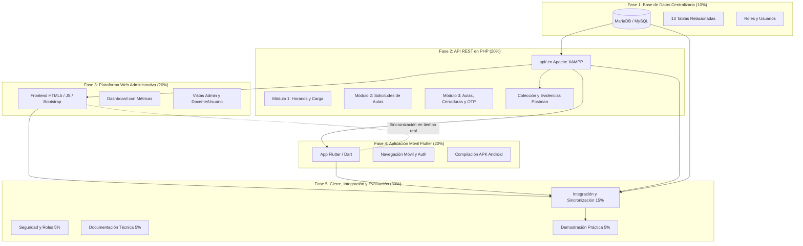

# AulaSync — Organigrama de Trabajo por Sesiones y Minutas
**Asignatura:** Programación de Redes  
**Profesor:** Dr. Aurelio Mex Mex  
**Carrera:** TSU en Infraestructura de Redes Digitales (4° Cuatrimestre) — UTM  
**Proyecto Integrador:** AulaSync — Sistema Inteligente de Gestión y Control de Acceso Mediante Cerraduras Digitales IoT  
**Periodo:** 10 de noviembre al 26 de noviembre de 2026  

---

## 1. Calendario Oficial de Sesiones (Google Calendar / Materia)

De acuerdo con el horario institucional en Google Calendar (Grupo 4A-IRD), la materia cuenta con 3 sesiones semanales:
- **Martes:** 11:50 – 12:40 (Lab IOT F-107)
- **Miércoles:** 09:00 – 10:40 (Lab 9 C-114)
- **Jueves:** 09:00 – 10:40 (Lab 9 C-114)

### Matriz de Sesiones hasta el Cierre (26 de Noviembre)

| # Sesión | Día y Fecha | Horario | Ubicación | Eje de Trabajo / Entregable | Estado |
|---|---|---|---|---|---|
| **Base** | Jueves 05/Nov | 09:00 - 10:40 | Lab 9 (C-114) | **FASE 1 Concluida:** Base de datos (13 tablas, 20 FK, MariaDB, schema.sql) | ✅ Entregado |
| **Sesión 1** | Martes 10/Nov | 11:50 - 12:40 | Lab IOT (F-107) | **API REST (Fase 2.1):** Estandarización de endpoints JSON, CRUD Módulo 1 (Horarios/Carga Académica), Auth con sesiones/tokens y validación estricta | ⏳ Recuperando hoy |
| *Sin clase* | Miércoles 11/Nov | — | — | *Suspensión de labores académicas / Asueto* | ⏸️ Sin sesión |
| **Sesión 2** | Jueves 12/Nov | 09:00 - 10:40 | Lab 9 (C-114) | **API REST (Fase 2.2) + Web:** Endpoints CRUD Módulo 2 (Solicitudes) y Módulo 3 (Aulas/Accesos/OTP), integración con Frontend Web en Apache/XAMPP | 🎯 Sesión actual |
| **Sesión 3** | Martes 17/Nov | 11:50 - 12:40 | Lab IOT (F-107) | **Web Completo (Fase 3):** Dashboard Admin y Portal Usuario, formularios con validación, filtros de búsqueda, manejo de roles (Admin/Docente) y notificaciones | 📅 Próxima |
| **Sesión 4** | Miércoles 18/Nov | 09:00 - 10:40 | Lab 9 (C-114) | **Pruebas de API y Postman Collection:** Pruebas funcionales de todos los endpoints GET/POST/PUT/DELETE, códigos HTTP, colección y evidencias Postman | 📅 Programada |
| **Sesión 5** | Jueves 19/Nov | 09:00 - 10:40 | Lab 9 (C-114) | **App Móvil Flutter (Fase 4.1):** Estructura del proyecto Flutter, pantalla de Login, consumo de autenticación API REST y navegación inicial | 📅 Programada |
| **Sesión 6** | Martes 24/Nov | 11:50 - 12:40 | Lab IOT (F-107) | **App Móvil Flutter (Fase 4.2):** Implementación de los 3 módulos en Flutter (Horarios, Solicitudes y Apertura/OTP), consumo sincronizado con la API REST | 📅 Programada |
| **Sesión 7** | Miércoles 25/Nov | 09:00 - 10:40 | Lab 9 (C-114) | **Integración Total y Generación de APK:** Pruebas de sincronización Web ↔ API ↔ BD ↔ Flutter, generación de archivo APK funcional para Android | 📅 Programada |
| **Sesión 8** | Jueves 26/Nov | 09:00 - 10:40 | Lab 9 (C-114) | **EVALUACIÓN FINAL (40 Pts):** Documentación técnica completa (PDF), demostración en vivo (Web + Móvil + Postman) ante el Dr. Aurelio Mex Mex | 🏁 Evaluación Final |

---

## 2. Organigrama de Responsabilidades y Módulos de AulaSync

---

## 3. Minuta de Sesión — Martes 10 de Noviembre de 2026

**Hora:** 11:50 – 12:40  
**Lugar:** Laboratorio IoT (F-107)  
**Tema:** Fase 2.1 — Consolidación de la Arquitectura API REST y Módulo 1 (Carga Académica y Horarios)  

### Objetivos Planteados:
1. Revisar la estructura base de los servicios REST en `api/` para asegurar el cumplimiento estricto del formato JSON y códigos de estado HTTP (200, 201, 400, 401, 403, 404, 405, 500).
2. Completar y verificar los endpoints CRUD del **Módulo 1: Carga Académica y Horarios** (`api/carga_academica.php` y `api/horarios.php`):
   - `GET`: Listado de horarios asignados filtrado por docente, aula o día.
   - `POST`: Asignación de horario con validación de solapamiento de horarios y aulas.
   - `PUT/PATCH`: Modificación de asignación existente.
   - `DELETE`: Baja de asignación.
3. Asegurar el control de sesiones mediante tokens de sesión y verificación de rol (`admin` / `usuario`).

### Acuerdos y Estado de Avance:
- Se implementaron validadores estrictos en `api/helpers.php` (texto, números enteros, fechas ISO, horas 24h, enums y correos).
- Se comprobó la operación del Módulo 1 con base de datos MariaDB activa en XAMPP.

---

## 4. Minuta de Sesión — Jueves 12 de Noviembre de 2026 (Sesión de Hoy)

**Hora:** 09:00 – 10:40  
**Lugar:** Laboratorio 9 (C-114)  
**Tema:** Fase 2.2 — Endpoints de Solicitudes, Cerraduras/OTP e Integración Web  
*(Nota: El Miércoles 11 de Noviembre no hubo actividades académicas).*

### Objetivos de la Sesión:
1. **Módulo 2: Solicitudes de Aulas** (`api/solicitudes.php` y `api/solicitud_responder.php`):
   - Flujo de solicitud por parte del docente (usuario).
   - Flujo de aprobación/rechazo por parte del administrador.
   - Registro con timestamp y motivo/justificación.
2. **Módulo 3: Aulas, Cerraduras y OTP** (`api/aulas.php`, `api/otp_solicitar.php`, `api/cerradura_abrir.php`):
   - Consulta de aulas disponibles y su estado.
   - Generación de código temporal OTP de 6 dígitos con expiración de 5 minutos para apertura de cerradura.
   - Registro automático en bitácora de accesos (`accesos`).
3. **Conexión Web con XAMPP:**
   - Verificación de ejecución bajo Apache (`http://127.0.0.1:8099` o `http://localhost/`).
   - Sincronización del Dashboard administrativo (`dashboard.html`, `admin_horarios.html`, `admin_solicitudes.html`) consumiendo directamente la API REST.
4. **Respaldo y verificación en XAMPP:**
   - MariaDB activo en puerto 3306.
   - Apache activo en puerto 80/8099.
