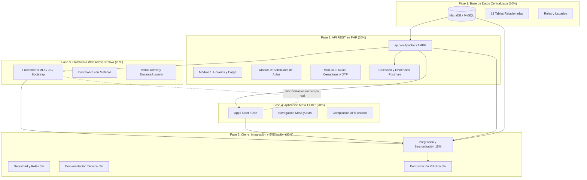

# AulaSync — Organigrama de Trabajo por Sesiones y Minutas
**Asignatura:** Programación de Redes  
**Profesor:** Dr. Aurelio Mex Mex  
**Carrera:** TSU en Infraestructura de Redes Digitales (4° Cuatrimestre) — UTM  
**Proyecto Integrador:** AulaSync — Sistema Inteligente de Gestión y Control de Acceso Mediante Cerraduras Digitales IoT  
**Periodo:** 10 de noviembre al 26 de noviembre de 2026  

---

## 1. Calendario Oficial de Sesiones (Google Calendar / Materia)

De acuerdo con el horario institucional en Google Calendar (Grupo 4A-IRD), la materia cuenta con 3 sesiones semanales:
- **Martes:** 11:50 – 12:40 (Lab IOT F-107)
- **Miércoles:** 09:00 – 10:40 (Lab 9 C-114)
- **Jueves:** 09:00 – 10:40 (Lab 9 C-114)

### Matriz de Sesiones hasta el Cierre (26 de Noviembre)

| # Sesión | Día y Fecha | Horario | Ubicación | Eje de Trabajo / Entregable | Estado |
|---|---|---|---|---|---|
| **Base** | Jueves 05/Nov | 09:00 - 10:40 | Lab 9 (C-114) | **FASE 1 Concluida:** Base de datos (13 tablas, 20 FK, MariaDB, schema.sql) | ✅ Completada |
| **Sesión 1** | Martes 10/Nov | 11:50 - 12:40 | Lab IOT (F-107) | **API REST (Fase 2.1):** Estandarización de endpoints JSON, CRUD Módulo 1 (Horarios/Carga Académica), Auth con sesiones/tokens y validación estricta | ✅ Completada |
| *Sin clase* | Miércoles 11/Nov | — | — | *Suspensión de labores académicas / Asueto* | ⏸️ Sin sesión |
| **Sesión 2** | Jueves 12/Nov | 09:00 - 10:40 | Lab 9 (C-114) | **API REST (Fase 2.2) + Web:** Endpoints CRUD Módulo 2 (Solicitudes) y Módulo 3 (Aulas/Accesos/OTP), integración con Frontend Web en Apache/XAMPP | ✅ Completada |
| **Sesión 3** | Martes 17/Nov | 11:50 - 12:40 | Lab IOT (F-107) | **Web Completo (Fase 3):** Dashboard Admin y Portal Usuario, formularios con validación, filtros de búsqueda, manejo de roles (Admin/Docente) y notificaciones | ✅ Completada |
| **Sesión 4** | Miércoles 18/Nov | 09:00 - 10:40 | Lab 9 (C-114) | **Pruebas de API y Postman Collection:** Pruebas funcionales de todos los endpoints GET/POST/PUT/DELETE, códigos HTTP, colección y evidencias Postman | ✅ Completada |
| **Sesión 5** | Jueves 19/Nov | 09:00 - 10:40 | Lab 9 (C-114) | **App Móvil Flutter (Fase 4.1):** Estructura del proyecto Flutter, pantalla de Login, consumo de autenticación API REST y navegación inicial | ✅ Completada |
| **Sesión 6** | Martes 24/Nov | 11:50 - 12:40 | Lab IOT (F-107) | **App Móvil Flutter (Fase 4.2):** Implementación de los 3 módulos en Flutter (Horarios, Solicitudes y Apertura/OTP), interfaz Material 3 Expressive y consumo sincronizado con la API REST | ✅ Completada |
| **Sesión 7** | Miércoles 25/Nov | 09:00 - 10:40 | Lab 9 (C-114) | **Integración Total y Ejecución Web Chrome (`flutter -d chrome`):** Pruebas de sincronización bidireccional Web ↔ API ↔ BD ↔ Flutter (37/37 E2E) sin compilación APK | ✅ Completada |
| **Sesión 8** | Jueves 26/Nov | 09:00 - 10:40 | Lab 9 (C-114) | **EVALUACIÓN FINAL (40 Pts):** Documentación técnica completa (PDF), demostración en vivo (Web + Flutter Chrome + Postman) ante el Dr. Aurelio Mex Mex | 🏁 Lista para Evaluación Final |

---

## 2. Organigrama de Responsabilidades y Módulos de AulaSync

---

## 3. Minuta de Sesión — Martes 10 de Noviembre de 2026

**Hora:** 11:50 – 12:40  
**Lugar:** Laboratorio IoT (F-107)  
**Tema:** Fase 2.1 — Consolidación de la Arquitectura API REST y Módulo 1 (Carga Académica y Horarios)  

### Objetivos Planteados:
1. Revisar la estructura base de los servicios REST en `api/` para asegurar el cumplimiento estricto del formato JSON y códigos de estado HTTP (200, 201, 400, 401, 403, 404, 405, 500).
2. Completar y verificar los endpoints CRUD del **Módulo 1: Carga Académica y Horarios** (`api/carga_academica.php` y `api/horarios.php`):
   - `GET`: Listado de horarios asignados filtrado por docente, aula o día.
   - `POST`: Asignación de horario con validación de solapamiento de horarios y aulas.
   - `PUT/PATCH`: Modificación de asignación existente.
   - `DELETE`: Baja de asignación.
3. Asegurar el control de sesiones mediante tokens de sesión y verificación de rol (`admin` / `usuario`).

### Acuerdos y Estado de Avance:
- Se implementaron validadores estrictos en `api/helpers.php` (texto, números enteros, fechas ISO, horas 24h, enums y correos).
- Se comprobó la operación del Módulo 1 con base de datos MariaDB activa en XAMPP.

---

## 4. Minuta de Sesión 2 — Jueves 12 de Noviembre de 2026

**Hora:** 09:00 – 10:40  
**Lugar:** Laboratorio 9 (C-114)  
**Tema:** Fase 2.2 — Endpoints de Solicitudes, Cerraduras/OTP e Integración Web  
*(Nota: El Miércoles 11 de Noviembre no hubo actividades académicas).*

### Objetivos de la Sesión (Completados):
1. **Módulo 2: Solicitudes de Aulas** (`api/solicitudes.php` y `api/solicitud_responder.php`):
   - Flujo de solicitud por parte del docente (`usuario`).
   - Flujo de aprobación/rechazo por parte del administrador con comentarios y registro temporal.
2. **Módulo 3: Aulas, Cerraduras y OTP** (`api/aulas.php`, `api/aulas_autorizadas.php`, `api/otp_solicitar.php`, `api/cerradura_abrir.php`):
   - Consulta de 30 aulas físicas disponibles y nodos IoT.
   - Generación de PIN OTP de 6 dígitos con expiración de 5 minutos y protección anti-replay (HTTP 409).
   - Registro automático en bitácora de accesos (`accesos`).
3. **Conexión Web con XAMPP:**
   - Ejecución bajo Apache (`http://localhost/aulasync/`) y MariaDB en puerto 3306.

---

## 5. Minuta de Sesión 3 — Martes 17 de Noviembre de 2026

**Hora:** 11:50 – 12:40  
**Lugar:** Laboratorio IoT (F-107)  
**Tema:** Fase 3 — Plataforma Web Administrativa y Portal Docente Completos  

### Entregables Completados:
- **Dashboard Administrativo (`dashboard.html` y `js/dashboard_api.js`):** KPIs en tiempo real (aulas disponibles, cerraduras online/offline, solicitudes pendientes, accesos del día) y control remoto de cerraduras (`api/nodo_control.php`).
- **Gestión Académica (`admin_horarios.html`):** Alta, listado y eliminación de carga académica con validación de conflictos y solapamientos.
- **Bandeja de Solicitudes (`admin_solicitudes.html`):** Revisión, aprobación y rechazo justificado de solicitudes docentes.
- **Portal Docente (`usuario.html`) y Simulador IoT (`cerradura.html`):** Vista semanal por días, generación de OTP y teclado digital interactivo conectado a MariaDB.

---

## 6. Minuta de Sesión 4 — Miércoles 18 de Noviembre de 2026

**Hora:** 09:00 – 10:40  
**Lugar:** Laboratorio 9 (C-114)  
**Tema:** Fase 2.3 — Pruebas Integrales de API REST y Colección Postman  

### Entregables Completados:
- **Rutas limpias y Router API:** Implementación de `api/.htaccess`, `api/index.php` y `api/usuarios.php` (CRUD de usuarios con bcrypt).
- **Colección y Guía Postman:** [`postman/AulaSync_API.postman_collection.json`](file:///c:/Users/Admin/Documents/Nueva%20carpeta/postman/AulaSync_API.postman_collection.json) y [`POSTMAN_GUIA_RAPIDA.md`](file:///c:/Users/Admin/Documents/Nueva%20carpeta/POSTMAN_GUIA_RAPIDA.md) con payloads JSON listos por endpoint.
- **Suite Automatizada (`tests/test_api_suite.py`):** **43 de 43 pruebas HTTP aprobadas (100%)** verificando códigos `200`, `201`, `401`, `403`, `409` y `422`.

---

## 7. Minuta de Sesión 5 — Jueves 19 de Noviembre de 2026

**Hora:** 09:00 – 10:40  
**Lugar:** Laboratorio 9 (C-114)  
**Tema:** Fase 4.1 — App Móvil Flutter (Estructura, Login y Navegación)  

### Entregables Completados:
- Proyecto Flutter modular en `mobile/` con soporte multiplataforma (Web Chrome / Android).
- Configuración dinámica de endpoint (`ApiConfig.baseUrl`) con autodetección `localhost` en Chrome Web (`kIsWeb`) y cabeceras CORS en `api/helpers.php`.
- Pantalla `LoginScreen` con autenticación Bearer Token, persistencia con `SharedPreferences` y barra de navegación `NavigationBar` de 4 destinos en `HomeScreen`.

---

## 8. Minuta de Sesión 6 — Martes 24 de Noviembre de 2026

**Hora:** 11:50 – 12:40  
**Lugar:** Laboratorio IoT (F-107)  
**Tema:** Fase 4.2 — App Móvil Flutter (Módulos CRUD + Material 3 Expressive)  

### Entregables Completados:
- **Módulo 1 (`horarios_tab.dart`):** Buscador en tiempo real, `FilterChip` por día con indicador de día actual y tarjetas con caché offline.
- **Módulo 2 (`solicitudes_tab.dart`, `nueva_solicitud_screen.dart`):** Listado con filtros por estado y formulario M3 con `SegmentedButton`, pickers de fecha/hora y chips de motivos sugeridos.
- **Módulo 3 (`otp_tab.dart`):** Selector de aulas, generador de PIN OTP de 6 dígitos con temporizador regresivo de 5 min, simulador de código QR con láser animado y apertura IoT en vivo.
- **Diseño Material 3 Expressive:** Interfaz responsiva optimizada para ejecución directa en `flutter -d chrome` (sin errores de análisis en `flutter analyze` y **12/12 tests aprobados** en `flutter test`).

---

## 9. Minuta de Sesión 7 — Miércoles 25 de Noviembre de 2026

**Hora:** 09:00 – 10:40  
**Lugar:** Laboratorio 9 (C-114)  
**Tema:** Fase 5 — Integración Total Bidireccional y Verificación E2E  

### Entregables Completados:
- **Suite End-to-End (`tests/test_e2e_sync.py`):** **37 de 37 aserciones aprobadas (100%)** validando el flujo completo Web ↔ API ↔ MariaDB ↔ App Flutter (Login, Conflictos 409, Solicitud, Aprobación, Ventana Activa, OTP, Apertura IoT, Anti-Replay 409, Bitácora y KPIs).
- **Despliegue de demostración:** Ejecución unificada en Apache/MariaDB (XAMPP) + `flutter run -d chrome` (omitiendo compilación de APK por definición del proyecto).

---

## 10. Preparación de Sesión 8 — Jueves 26 de Noviembre de 2026 (Evaluación Final)

**Hora:** 09:00 – 10:40  
**Lugar:** Laboratorio 9 (C-114)  
**Objetivo:** Demostración en vivo ante el Dr. Aurelio Mex Mex (40 Pts, F-SGC-033):
1. Documentación técnica consolidada (`docs/MATRIZ_EVALUACION_F-SGC-033.md`, `reporte/ORGANIGRAMA_Y_MINUTAS_SESIONES.pdf`, `reporte/FASE1_Reporte.pdf`).
2. Pruebas en vivo de Plataforma Web (`login.html`, `dashboard.html`, `usuario.html`, `cerradura.html`).
3. Pruebas en vivo de App Flutter en Chrome (`flutter run -d chrome`) sincronizada con MariaDB.
4. Pruebas de endpoints en Postman (`POSTMAN_GUIA_RAPIDA.md` y colección v2.1).
